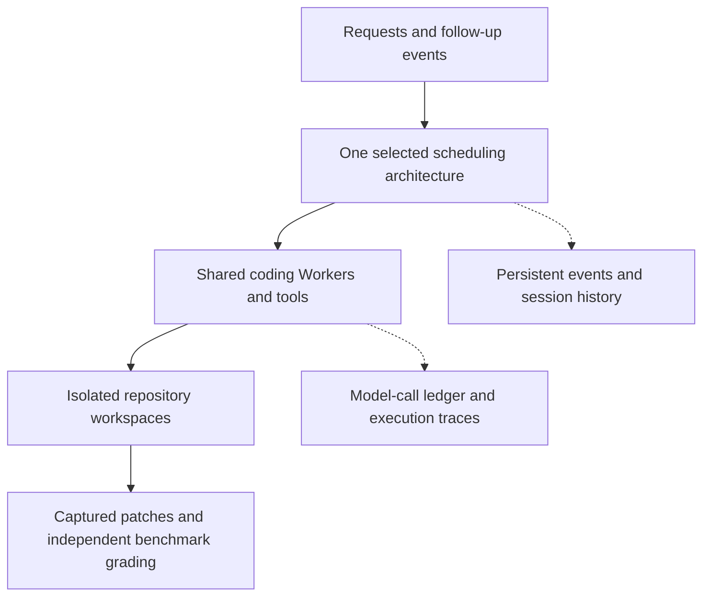

<p align="center">
  
</p>
<h1 align="center">OpenSuperAgent</h1>
<p align="center"><strong>Reproduce and compare how AI coding agents coordinate work.</strong><br>AI 编码 Agent 架构的开源复现与公平评测</p>
<p align="center">
  English · <a href="README.zh-CN.md">简体中文</a> ·
  <a href="#quick-start">Quick start</a> ·
  <a href="#results-and-research-status">Results</a> ·
  <a href="https://github.com/xinyuchen-pku/OpenSuperAgent/releases/tag/v0.1.4-research">Research preview v0.1.4</a>
</p>

## What is this?

OpenSuperAgent is a **research framework for evaluating multi-agent coding systems**. It runs five scheduling architectures through a shared coding Worker and tool interface, then measures task success, completion time, model tokens, and coordination overhead.

The research question is straightforward: **when does a persistent, event-driven Super-agent provide value beyond ordinary parallel delegation?** A persistent router retains coordination history; subscriptions can deliver follow-up events directly to the assigned Worker. The framework lets us test the benefits and costs of those mechanisms.

Use it to compare schedulers on controlled workloads, inspect why a coding task failed, replay published patches through benchmark graders, or study event delivery and recovery. Current real-model evidence is a small pilot; it has not established a consistent Super-agent advantage.

## Quick start

Start with the system checks. **Python 3.12 is recommended; no model key, GPU, Docker, or Node.js is needed for these commands.** The research package uses the Python standard library at runtime.

From a Linux or macOS terminal:

```bash
git clone https://github.com/xinyuchen-pku/OpenSuperAgent.git
cd OpenSuperAgent
python3.12 -m venv .venv-research
source .venv-research/bin/activate
python -m pip install --no-deps ./research

# Check that all five architectures can process requests and follow-ups.
python -m osa_eval.cli smoke --output research/results/smoke-001

# Measure concurrency, event subscriptions, and checkpoint recovery.
python research/reproduction/system_track.py research/results/system-001
```

The smoke summary is written to `research/results/smoke-001/summary.json`. System measurements are written to `research/results/system-001/RESULTS.json`. Both runs use scripted responses and make **zero real model API calls**. They establish system behavior; coding success is measured separately with real models and benchmark tests. The full System Track includes 147 measurement cells and may take several minutes. Choose a new output directory for each run.

<details>
<summary>Windows PowerShell</summary>

After cloning the repository, use the virtual environment's Python directly:

```powershell
py -3.12 -m venv .venv-research
.\.venv-research\Scripts\python.exe -m pip install --no-deps ./research
.\.venv-research\Scripts\python.exe -m osa_eval.cli smoke --output research/results/smoke-001
.\.venv-research\Scripts\python.exe research/reproduction/system_track.py research/results/system-001
```

The live benchmark workflow requires Linux and a container environment with verified resource limits.

</details>

For real coding tasks, follow the [benchmark setup and reproduction guide](research/reproduction/INSTALL.txt). Those runs additionally require a model endpoint, pinned benchmark inputs, container images, and the benchmark's original scoring environment. The [capability guide](research/reproduction/RUN-CAPABILITY.md) describes the current Worker setup and captured-patch replay; the [M2 guide](research/reproduction/INSTALL-M2-source022.txt) reproduces the historical five-architecture comparison with its original version.

## Five architectures, one shared coding kernel

A **Worker** reads the repository, edits code, and runs tools. A **Router** decides where a request goes. Model, tools, tasks, and resource budgets are controlled across comparisons; scheduling, session history, and event paths are the experimental variables.

| Architecture | What changes |
| --- | --- |
| **Single** | A shared main session executes requests sequentially. |
| **Single + Subagent** | The main session chooses whether to do the work itself or delegate. |
| **Eager Delegation** | The main session delegates every request to a task-specific Worker. |
| **Router–Worker** | Each event uses a fresh Router context and is delegated to a Worker. |
| **Super-agent** | A persistent Router receives Worker reports; subscriptions can send later events directly to existing Workers. |

These are **task-level** comparisons. Each coding task retains its own repository workspace.



## Results and research status

**Research preview, not a completed architecture study.** Published results include failures, token use, execution traces, and original scoring evidence.

| Evidence | What we have learned | Read more |
| --- | --- | --- |
| **Five-architecture pilot** — 4 tasks × 3 seeds | Super-agent resolved 2/12 runs; Eager Delegation and Single + Subagent each resolved 3/12. There are only four independent tasks. | [M2 report](research/M2-REPORT-003.md) |
| **Shared Worker calibration** — 3 tasks, 1 seed | Qwen3-Coder-Next + the shared kernel resolved 1/3; Qwen30B + the same kernel resolved 0/3. The Next configuration is the candidate for broader evaluation. | [M3-A3 report](research/studies/m3-a3/README.md) |
| **System mechanisms** — 147 controlled cells, plus restart checks | Parallel execution and subscription bypass work on deterministic workloads. The measurements establish mechanism behavior, not real coding success. | [System Track](research/studies/m3-a3/SYSTEM-REPORT.md) |

Worker calibration is closed. The next architecture pilot uses four previously unrun tasks from the original frozen 24-task list, the same Next model and Worker, five architectures, and one seed. Its [preregistered setup](research/studies/m3-b1/README.md) is published. The first B1 attempt stopped at its accounting gate after a model-request timeout; no completed B1 architecture comparison is included in this release. The full 24-task, three-seed, 1/4-slot comparison remains the next expansion.

Historical results keep their original code identity: **M2 uses source022; the current shared kernel is source025 / package 0.1.4.** Repeated seeds are repeated measurements of the same task, not additional independent tasks.

## Reproduction and documentation

| I want to… | Start here |
| --- | --- |
| Understand the research scope and versions | [Research overview](research/START-HERE.md) |
| Install and choose a reproduction route | [Installation](research/reproduction/INSTALL.txt) |
| Inspect fairness rules, budgets, and metrics | [Evaluation protocol](research/PROTOCOL.md) |
| Regrade a captured patch without calling a model | [Public example](research/public-example/README.md) · [current Worker replay](research/reproduction/RUN-CAPABILITY.md#仅重放本轮source025成功补丁) |
| Reproduce the historical five-architecture model runs | [Frozen M2 instructions](research/reproduction/INSTALL-M2-source022.txt) |
| Run native AsynCodeBench assignments | [Native runbook](research/NATIVE-RUNBOOK.md) · [local setup](research/reproduction/NATIVE-LOCAL.md) |
| Find the implementation | [Schedulers](research/osa_eval/runtime.py) · [Worker kernel](research/osa_eval/kernel.py) · [benchmark campaign](research/osa_eval/campaign.py) |

Live SWE-bench Pro runs validate task/image identities, network boundaries, and actual per-task **1 CPU / 4 GB** limits before scoring. API credentials stay on the host. Original grader output, patches, SQLite journals, model/tool traces, and actual versus reserved tokens are kept as evidence. Models and benchmark images are obtained separately.

## Scope and current limits

This is an independent research implementation inspired by [DeepSeek's public SuperAgent prototype](https://github.com/deepseek-ai/dsh-superagent-prototype). The pinned upstream domain core is available through a separate adapter. The project is independently maintained and has no affiliation with DeepSeek.

- The complete DSH host, full Watchdog behavior, and recursive delegation inside one coding task remain integration work.
- Recovery covers acknowledged checkpoints. Interrupted operations with uncertain external effects require reconciliation before replay.
- Native AsynCodeBench preserves its own task decomposition, permissions, coordination, and scoring. The current assignment adapter replaces the Worker; a cross-architecture native coordinator comparison still needs a compatible integration.
- Small model pilots, human counterfactual repairs, and deterministic system measurements have separate evidence scopes.

### What about the web workspace?

The repository also contains an earlier local coding workspace in `server/` and `src/`. Its [setup guide](docs/getting-started.md) and [browser demo](https://xinyuchen-pku.github.io/OpenSuperAgent/) remain available. It has a separate executor and is a UI demonstration, not the benchmark evaluation interface. You do not need it to run the research framework.

## License and contributions

MIT © 2026 Xinyu Chen. Retained third-party code, task artifacts, fonts, and icons keep their original notices; see [third-party notices](research/reproduction/THIRD-PARTY-NOTICES.md), [contributing](CONTRIBUTING.md), and [security](SECURITY.md). The [logo and generation prompts](docs/BRANDING.md) are included in the repository.
