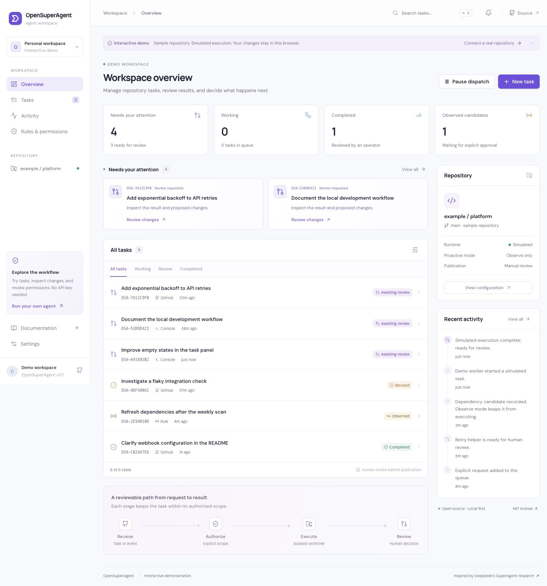

# OpenSuperAgent

**A local-first coding agent workspace: explicit permissions, isolated execution, and reviewable results.**

[Interactive demo](https://xinyuchen-pku.github.io/OpenSuperAgent/) · [Quick start](docs/getting-started.md) · [Architecture](docs/architecture.md) · [中文说明](README.zh-CN.md)

OpenSuperAgent turns repository requests into durable tasks. A bounded model worker reads and edits files in a separate Git worktree; the console brings together the request, authorization, changes, and execution history. You decide when the result is ready and publish it yourself.

This is an independent implementation inspired by [DeepSeek’s SuperAgent research prototype](https://github.com/deepseek-ai/dsh-superagent-prototype). It is not affiliated with DeepSeek. See the [research notes and deliberate differences](docs/research.md).



## What works

- **A real coding loop.** An OpenAI-compatible chat-completions provider drives bounded file tools in an isolated Git worktree. DeepSeek is the default provider.
- **Durable task orchestration.** SQLite stores requests, mandates, state transitions, attempt counts, source cursors, and an ordered event history.
- **A review console.** Create and search tasks, inspect local diffs, provide follow-up context, retry blocked work, stop a task, and pause new dispatch.
- **GitHub intake.** Signed webhooks accept explicitly addressed requests from configured actors. Optional read-only polling also observes labeled issue candidates.
- **Explicit authorization.** Observed candidates wait for a human decision. Incoming text cannot change configured permissions.
- **Recoverable execution.** Interrupted tasks become blocked on restart. Existing workspaces survive stops, retries, and normal shutdown. No automatic cleanup.
- **A self-contained demo.** GitHub Pages runs the same console with browser-local sample data and clearly labeled simulated execution. No credentials, model calls, or GitHub writes.

## Quick start

Requirements: **Node.js 22+**, **pnpm 11**, **Python 3.9+**, and **Git** on macOS or Linux.

```bash
git clone https://github.com/xinyuchen-pku/OpenSuperAgent.git
cd OpenSuperAgent
pnpm install --frozen-lockfile
pnpm build
python3 -m server.app
```

Open **http://127.0.0.1:8765**. The runtime starts without a model key so you can inspect an empty local workspace. To execute real tasks, configure the environment before starting:

```bash
export OSA_REPO=/absolute/path/to/your/repository
export OSA_BASE_URL=https://api.deepseek.com
export OSA_MODEL=deepseek-flash
# Set OSA_API_KEY securely in the environment; do not commit it.
python3 -m server.app
```

The Python runtime uses the standard library only. The public demo is separate from your local runtime and never asks for keys. Read the [setup guide](docs/getting-started.md) for GitHub sources, development, and compatible providers.

## How work moves


Marking a task reviewed changes its local status. It does not commit, push, open a pull request, or merge. The current built-in executor has **no shell or test runner**; its final result must explain that tests were not run. Execute your repository’s checks before publication.

## Scope and trust

| Capability | Current implementation |
| --- | --- |
| Task workspaces | One Git worktree and branch per task, starting from the configured checkout’s committed `HEAD` |
| File tools | List, read UTF-8 text, create/replace UTF-8 text, inspect diffs |
| Limits | 2 workers; 20 model steps per attempt; 8 tools per step; 64 KiB per file operation |
| Source policy | Allowed GitHub actors + exact repository + agent mention; labeled candidates remain observed |
| Retention | SQLite history and worktrees retained; no task or workspace deletion endpoint |
| Delivery | Local review and manual publication |

Use a repository you trust. Git worktrees share the repository’s Git metadata and are **not an operating-system sandbox**. The worker cannot request arbitrary shell execution through its tools, but Git operations use the operator’s account and repository configuration. File-path checks protect the tool boundary; they do not isolate hostile processes running as the same OS user. Files read by the worker are sent to the configured model provider. Secret-path filters are defense in depth; keep secrets out of the selected repository.

This is a focused **v0.1 engineering preview**, not a production multi-tenant service. Automatic pull-request delivery, Feishu, conversational thread subscriptions, arbitrary shell workers, autonomous rule generation, and distributed execution are outside this release. See [security boundaries](SECURITY.md).

## Development and validation

```bash
python3 -m unittest discover -s tests -v
pnpm build
pnpm dev
```

The suite exercises admission, concurrency, restart recovery, stop races, file boundaries, signed HTTP intake, a real Git worktree, and a scripted model tool loop. Scripted provider tests establish protocol and runtime behavior; model quality and commercial-provider availability depend on your selected provider. See [validation evidence](docs/validation.md).

## Documentation

- [Getting started and configuration](docs/getting-started.md)
- [Architecture and state transitions](docs/architecture.md)
- [Research notes and upstream comparison](docs/research.md)
- [Validation scope](docs/validation.md)
- [Contributing](CONTRIBUTING.md)
- [Security](SECURITY.md)

## License and credits

MIT © 2026 Xinyu Chen. Independently written application code; upstream research is credited in the design notes. The bundled DM Sans and Manrope fonts retain their respective SIL Open Font License files. Icons are provided by Lucide under the ISC license.
