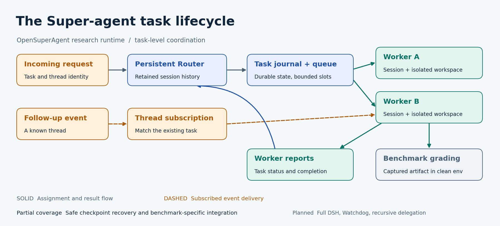
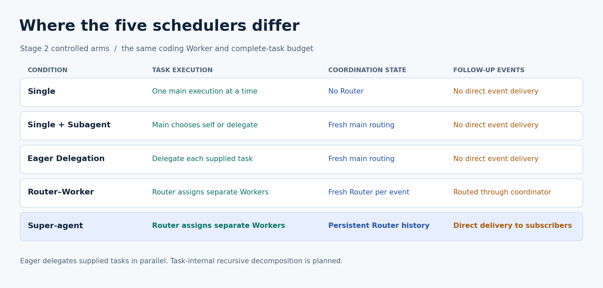
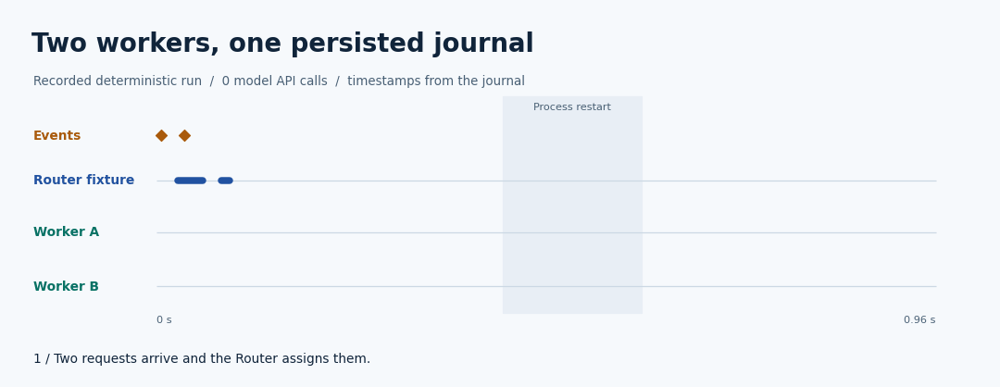
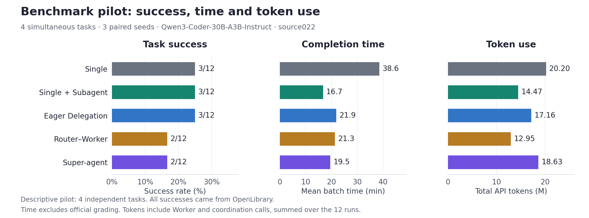

<p align="center">
  
</p>
<h1 align="center">OpenSuperAgent</h1>
<p align="center"><strong>面向持续在线、事件驱动多 Agent 系统的开源框架与评测套件</strong></p>
<p align="center">
  <a href="README.md">English</a> · 简体中文 ·
  <a href="docs/getting-started.md">快速开始</a> ·
  <a href="docs/results.md">评测结果</a>
</p>

OpenSuperAgent 受 DeepSeek 公开 Super-agent 原型启发，实现任务级 Router–Worker 架构。持久 Router 将请求分派给拥有独立会话和工作区的 Worker，线程订阅让相关后续事件到达正在处理任务的 Worker。**框架**运行这一设计，**评测套件**在同模型、同预算下比较它与常规委派方案。

[](docs/architecture/overview.svg)

## 为什么需要持续协调？

并行委派适合同时到达的任务。持久 Router 可以保留多次请求的协调上下文，已订阅的 Worker 可以直接收到相关更新。我们用同一个编码 Worker 比较五种任务级调度，测量这些机制何时影响任务完成率、延迟和 token 消耗。

[](docs/architecture/comparison.svg)

[架构说明及与公开原型的对应关系](docs/architecture/README.md)

## 看一次运行

[](docs/architecture/event-timeline.svg)

**32 秒确定性运行回放。** 两个 Worker 并行执行并保存状态，第二个进程恢复后收到后续事件。动画基于日志时间戳，模型 API 调用为零。[轨迹、静态时间线和重现命令](docs/architecture/README.md#recorded-demo)

**真实编码案例。** 在 Eager Delegation 的一次实测中，Qwen Worker 修改了 OpenLibrary 的目录处理。原始补丁通过 13/13 项必需测试，Harbor 官方评分为 1。[任务指令、实际动作、补丁和复现](docs/case-studies/openlibrary.md)

## 仓库提供什么？

| 目录 | 用途 |
| --- | --- |
| [`research/`](research/START-HERE.md) | **研究框架**。任务级 Router–Worker、共同 Worker 和历史实验证据 |
| [`suite/`](suite/README.md) | **评测套件**。冻结清单、五种受控架构、原生评测适配和报告 |
| [`src/`、`server/`、`public/`](docs/getting-started.md#web-workspace) | **网页工作区**。浏览器界面，使用独立的本地执行器 |
| [`docs/`](docs/architecture/README.md) | 架构图、可运行演示及使用说明 |

## 快速开始

使用 Python 3.11 或更新版本，在仓库根目录运行。演示只依赖标准库，每次使用新的输出目录。

```bash
python docs/architecture/run_demo.py --output osa-demo
```

输出包含两个独立进程的回执、Worker 活动和订阅交付记录。[安装评测命令并查看实验计划](docs/getting-started.md)

## 评测结果

[](docs/results/benchmark-pilot.svg)

受控试点使用 Qwen3-Coder-30B-A3B-Instruct 与 source022，覆盖 **4 题 × 3 个配对种子**。Eager Delegation 和 Single + Subagent 各成功 3/12，Super-agent 成功 2/12。成功案例都来自 OpenLibrary。[结果表、成对矩阵及其他实测](docs/results.md)

Stage 2 已准备 Pro V2 的 120 题独立候选子集与 AsynCodeBench 19 题原生计划。正式成绩等待运行环境准入。[评测设计、基线与协议边界](docs/benchmarks.md)

## 复现实验

- [用官方评分器重放已捕获的 OpenLibrary 补丁](research/public-example/README.md)
- [从冻结数据重新生成公开结果图](docs/results/README.md)
- [用统一评测命令准备并运行 Stage 2](suite/README.md)

## 实现状态

| 能力 | 证据 |
| --- | --- |
| 任务分派与并行 Worker | 已实现任务级调度，已通过实测和系统测试 |
| 持久 Router 与订阅 | 已实现，已有确定性测试和有限的真实模型证据 |
| 原生角色的工作区约束 | Docker 样例已检查文件范围和角色读取隔离，待 Stage 2 原生运行验收 |
| 进程恢复 | 已演示从安全持久化检查点恢复 |
| 完整 Watchdog、任务内递归委派、DSH 宿主集成 | 计划中 |

[详细状态和验收证据](docs/implementation-status.md)

[历史研究](research/START-HERE.md) · [引用与上游资料](docs/architecture/README.md#citation) · [MIT 许可](LICENSE) · [第三方声明](research/reproduction/THIRD-PARTY-NOTICES.md) · [参与贡献](CONTRIBUTING.md)
