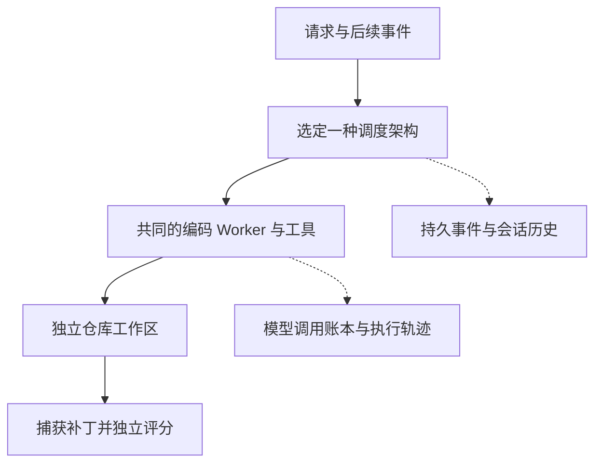

<p align="center">
  
</p>
<h1 align="center">OpenSuperAgent</h1>
<p align="center"><strong>AI 编码 Agent 架构的开源复现与公平评测</strong></p>
<p align="center">
  <a href="README.md">English</a> · 简体中文 ·
  <a href="#快速开始">快速开始</a> ·
  <a href="#已有结果与研究进度">已有结果</a> ·
  <a href="https://github.com/xinyuchen-pku/OpenSuperAgent/releases/tag/v0.1.4-research">研究预览版 v0.1.4</a>
</p>

## 这个项目在做什么？

OpenSuperAgent 是一个**研究 AI 编码 Agent 协作方式的评测框架**。它让五种调度架构使用共同的编码 Worker 和工具接口，在代码任务上比较成功率、完成时间、模型 tokens 和协调开销。

我们想回答的问题是：**持续在线、能够处理后续事件的 Super-agent，在什么条件下能比普通并行委派带来额外收益？** 持久 Router 会保留协调历史；Subscription（订阅）可以把后续事件直接送到对应 Worker。这个框架用于测量这些机制的收益与成本。

你可以用它比较调度方式、查看编码失败轨迹、用原始评分器重放已公开的补丁，或者测试事件投递与进程恢复。目前真实模型结果仍是小规模 Pilot，尚未建立 Super-agent 稳定领先的证据。

## 快速开始

先运行系统检查。**推荐 Python 3.12；下面的命令无需模型密钥、GPU、Docker 或 Node.js。** 研究内核的运行依赖为 Python 标准库。

在 Linux 或 macOS 终端中执行：

```bash
git clone https://github.com/xinyuchen-pku/OpenSuperAgent.git
cd OpenSuperAgent
python3.12 -m venv .venv-research
source .venv-research/bin/activate
python -m pip install --no-deps ./research

# 检查五种架构能否处理请求和后续事件。
python -m osa_eval.cli smoke --output research/results/smoke-001

# 测量并发、事件订阅和检查点恢复。
python research/reproduction/system_track.py research/results/system-001
```

第一项的汇总文件是 `research/results/smoke-001/summary.json`；第二项的测量结果保存在 `research/results/system-001/RESULTS.json`。两项均使用预设回复，**真实模型 API 调用为零**。它们验证系统行为；代码任务成功率需要另外使用真实模型和 Benchmark 测试。完整 System Track 包含 147 个测量单元，可能需要数分钟。每次运行请使用新的输出目录。

<details>
<summary>Windows PowerShell 命令</summary>

克隆仓库后，直接使用虚拟环境中的 Python：

```powershell
py -3.12 -m venv .venv-research
.\.venv-research\Scripts\python.exe -m pip install --no-deps ./research
.\.venv-research\Scripts\python.exe -m osa_eval.cli smoke --output research/results/smoke-001
.\.venv-research\Scripts\python.exe research/reproduction/system_track.py research/results/system-001
```

真实 Benchmark 运行需要 Linux，以及资源限制经过验证的容器环境。

</details>

执行真实代码任务前，请按[安装与复现指南](research/reproduction/INSTALL.txt)准备模型接口、固定版本的 Benchmark 输入、容器镜像和原始评分环境。[能力评测指南](research/reproduction/RUN-CAPABILITY.md)说明当前 Worker 的运行与补丁重放；[M2 指南](research/reproduction/INSTALL-M2-source022.txt)用于复现原版本的历史五架构对照。

## 五种架构，共同的编码内核

**Worker** 负责阅读仓库、编辑代码和执行工具；**Router** 负责决定请求交给谁。比较时控制模型、工具、任务和资源预算，调度方式、会话历史与事件路径属于实验变量。

| 架构 | 具体执行方式 |
| --- | --- |
| **Single** | 共享主会话，依次执行请求。 |
| **Single + Subagent** | 主会话决定自己执行，或委派给独立 Worker。 |
| **Eager Delegation** | 主会话把每个请求都委派给对应任务的 Worker。 |
| **Router–Worker** | 每个事件使用新的 Router 上下文，再委派给 Worker。 |
| **Super-agent** | 持久 Router 接收 Worker 结果；订阅可把后续事件直接送到已有 Worker。 |

这里比较的是**任务级调度**，每个编码任务使用独立的仓库工作区。



## 已有结果与研究进度

**当前为研究预览版，完整架构研究仍在进行。** 已公开失败案例、tokens、执行轨迹和原始评分证据。

| 评测 | 已观察到的结果 | 详细材料 |
| --- | --- | --- |
| **五架构 Pilot**：4 题 × 3 个种子 | Super-agent 成功 2/12；Eager Delegation、Single + Subagent 各 3/12。独立任务数仍为 4。 | [M2 报告](research/M2-REPORT-003.md) |
| **共同 Worker 校准**：3 题、1 个种子 | Qwen3-Coder-Next + 共同内核成功 1/3；Qwen30B + 相同内核为 0/3。后续扩大评测采用 Next 作为模型候选。 | [M3-A3 报告](research/studies/m3-a3/README.md) |
| **系统机制测试**：147 个条件单元，另有重启检查 | 确定性工作负载下的并行执行、订阅直通等机制已经验证；这些测量说明机制行为，真实编码能力另行评测。 | [System Track](research/studies/m3-a3/SYSTEM-REPORT.md) |

Worker 校准已结束。下一轮架构 Pilot 从原冻结 24 题清单中选择此前未运行的 4 题，使用相同 Next 模型与 Worker、五种架构和一个种子。[预登记方案](research/studies/m3-b1/README.md)已经公开。B1 首轮因模型请求超时触发用量未确认的停止条件，本次发行尚无完整 B1 架构对照结果。随后计划扩展为原 24 题、三个种子、1/4 槽位的正式比较。

历史结果保留原始版本身份：**M2 使用 source022；当前共同内核为 source025，安装包版本为 0.1.4。** 同一道题的多个种子是重复测量，独立题目数量按任务计算。

## 复现与文档导航

| 我想做什么 | 对应入口 |
| --- | --- |
| 了解研究范围和版本关系 | [研究总览](research/START-HERE.md) |
| 安装并选择复现路线 | [安装说明](research/reproduction/INSTALL.txt) |
| 查看公平性要求、预算和统计口径 | [评测协议](research/PROTOCOL.md) |
| 直接重放公开补丁，避免重新调用模型 | [公开示例](research/public-example/README.md) · [当前 Worker 重放](research/reproduction/RUN-CAPABILITY.md#仅重放本轮source025成功补丁) |
| 复现历史五架构真实模型对照 | [M2 冻结版本指南](research/reproduction/INSTALL-M2-source022.txt) |
| 执行原生 AsynCodeBench 任务 | [原生运行指南](research/NATIVE-RUNBOOK.md) · [本地环境说明](research/reproduction/NATIVE-LOCAL.md) |
| 阅读核心实现 | [调度器](research/osa_eval/runtime.py) · [编码内核](research/osa_eval/kernel.py) · [Benchmark 执行](research/osa_eval/campaign.py) |

真实 SWE-bench Pro 评测会核对任务和镜像身份、网络边界及实际生效的每任务 **1 CPU / 4 GB** 限制。API 凭据保留在宿主环境中。原始评分、补丁、SQLite 日志、模型与工具轨迹，以及实际 tokens 和预留额度分别记录。模型权重和容器镜像需要另行获取。

## 实现范围与当前限制

本项目受到 [DeepSeek 公开 SuperAgent 原型](https://github.com/deepseek-ai/dsh-superagent-prototype)启发，提供固定版本原始领域核心的独立适配器，由本项目独立维护，与 DeepSeek 没有隶属关系。

- 完整 DSH 宿主、完整 Watchdog 行为和单个任务内部的递归委派仍需集成。
- 恢复覆盖已经确认的检查点；中断时外部操作的结果尚不明确，则需先核对再重放。
- 原生 AsynCodeBench 保留自身任务分解、权限、协调和评分。当前适配器替换的是 Worker，跨架构的原生协调对照仍需兼容的集成入口。
- 小规模真实模型结果、人工反事实修复和确定性系统测量分别记录证据范围。

### 仓库里的网页工作台是什么？

`server/` 和 `src/` 保留了此前开发的本地编码工作台，可以查看[启动文档](docs/getting-started.md)和[浏览器演示](https://xinyuchen-pku.github.io/OpenSuperAgent/)。它使用独立执行器，展示任务管理界面；Benchmark 评测使用上面的研究模块。运行研究框架无需启动网页工作台。

## 许可与参与

MIT © 2026 Xinyu Chen。保留的第三方代码、任务材料、字体和图标沿用各自的许可说明，详见[第三方声明](research/reproduction/THIRD-PARTY-NOTICES.md)、[贡献指南](CONTRIBUTING.md)和[安全说明](SECURITY.md)。[Logo 与生成提示词](docs/BRANDING.md)随仓库提供。
