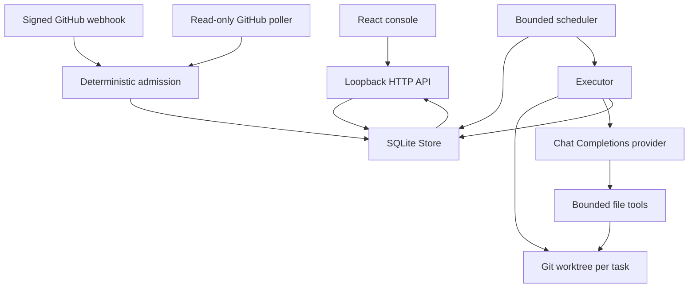
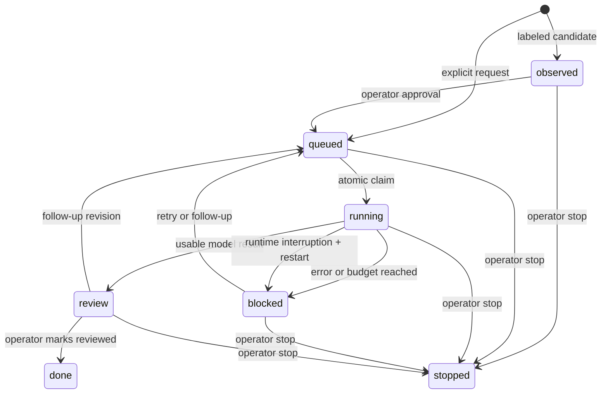

# Architecture

OpenSuperAgent separates authorization, durable state, model execution, and presentation. The backend uses Python’s standard library; the console uses React, TypeScript, Vite, and Lucide.

## Ownership

| Module | Responsibility |
| --- | --- |
| `server/core.py` | Task admission, mandates, state transitions, atomic claims, follow-up context, event history, restart recovery |
| `server/executor.py` | Worktree preparation, provider transport, bounded tool loop, path checks, result and diff capture |
| `server/sources.py` | Optional GitHub issue polling, source cursor, observed-label rule, durable source identity |
| `server/app.py` | Loopback API, webhook signatures, worker scheduling, source lifecycle, single-runtime lock |
| `src/App.tsx` | Operator console and task review flows |
| `src/demo.ts` | Clearly labeled simulated runtime for the public static demo |

## Task state

Tasks and model attempts are separate: every claim increments the attempt count; retries retain the same task, mandate and workspace. A late worker status update cannot change a stopped task back into review or blocked. Stopping does not delete artifacts.

Admission and source identities are deterministic. The model handles the requested coding work, not permission decisions. A labeled candidate receives no worker until the operator explicitly approves it. Policy is fixed to `v1` in this release and is not editable through task text.

## Persistence and concurrency

SQLite runs in WAL mode. Store mutations hold an in-process reentrant lock and commit atomically. Claims choose one queued task and set it running in the same transaction. Two worker threads can execute concurrently. An OS-level lock prevents multiple runtimes from opening the same state directory and conflicting with recovery.

The optional GitHub source has a durable cursor. Overlapping reads are idempotent. Webhook and polling issue events share `github-issue:<repository>:<number>`; comments use the GitHub delivery ID. No source performs GitHub writes.

## Worker contract

The provider receives the task request and tool definitions. Every turn may return tool calls or a final response. Available tools are `list_files`, `read_file`, `write_file`, and `git_diff`. Arguments are checked before file operations, and errors return as tool results. Arbitrary shell execution is absent.

The tool loop has limits of 20 model steps and 8 calls per step. A file read or write is limited to 64 KiB. Diffs are display previews capped at 200,000 characters; the full worktree remains the authoritative artifact. Common secret paths, Git metadata, symlinks, binary overwrites, and checkpoint/weight extensions are blocked. These checks do not isolate other OS processes or inspect every possible secret-bearing filename.

Provider requests use HTTPS, except on loopback; redirects are rejected. Model continuation fields required by thinking-enabled providers remain in memory and are not displayed. Error bodies from remote providers are not included in task results. There is no commercial-provider call in the deterministic test suite.

## Deliberate boundaries

The current version addresses a single configured repository. A task produces local changes, not a verified pull request. Repository checks, network isolation, operating-system sandboxing, identity administration, production ingress and publishing remain operator responsibilities. See [SECURITY.md](../SECURITY.md) and the [upstream comparison](research.md).
