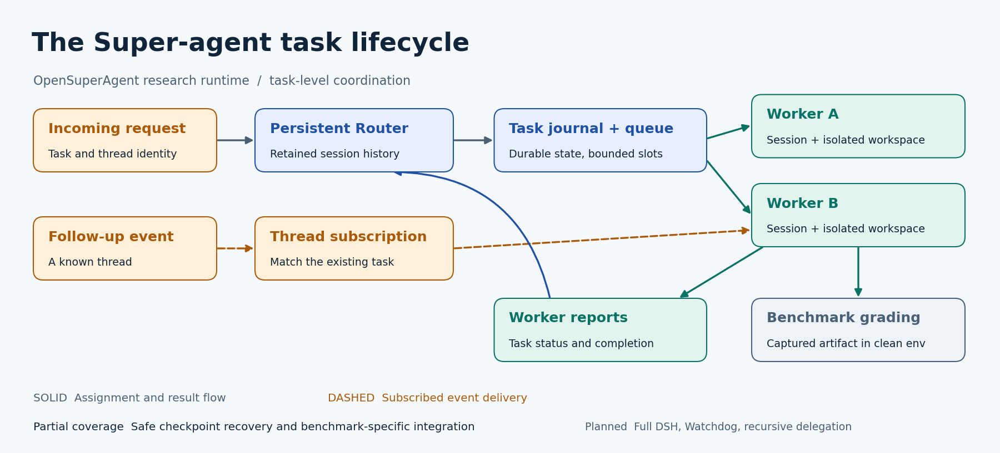
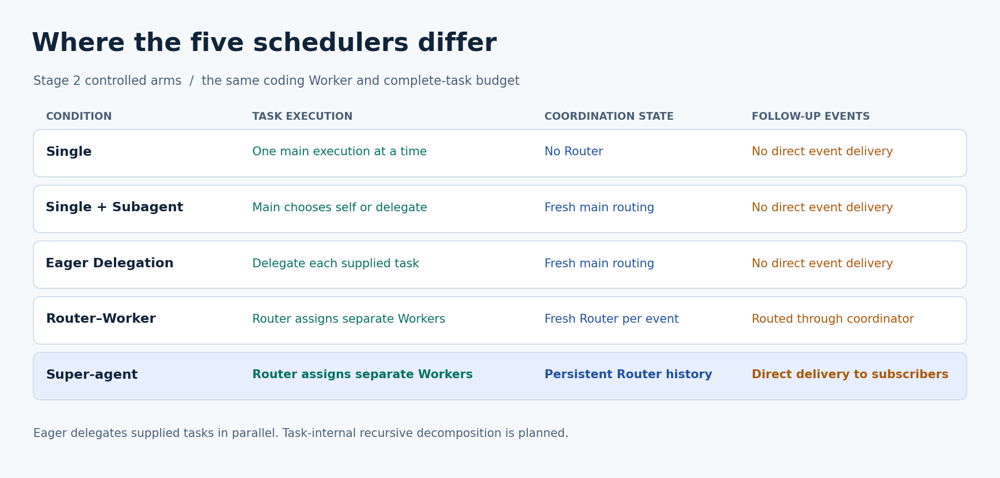
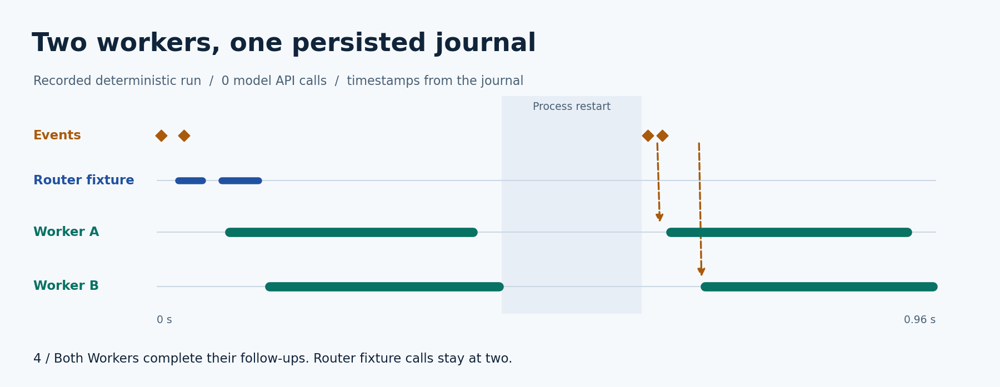

# Super-agent architecture

[](overview.svg)

A request identifies a task and a thread. The Router chooses the assignment and
persists its session. The task journal holds status, inputs and subscription
targets, while the scheduler bounds active Worker slots. Each Worker uses its
own conversation and workspace. Workers report completion to the Router.
Benchmark drivers capture artifacts and grade them separately in clean evaluators.

A follow-up on a subscribed thread enters the existing task's inbox. A completed
task can receive another assignment against the same saved session. Durable state
supports restart at safe checkpoints. The runtime requires explicit reconciliation
when an interrupted model or tool request has an uncertain outcome.

## Mapping to the public DeepSeek design

| Public concept | Research implementation | Coverage |
| --- | --- | --- |
| Trigger and Thread | Event ID, thread ID and optional task target | Requests and follow-ups in the task runtime |
| Ticket, Assignment, Executor | Journal task record, Worker session and workspace | Task-level assignment with a slot limit |
| Router Session | Persisted Router message history | Retention and restart at a safe checkpoint |
| Thread Subscription | Durable thread-to-task registry and inbox | Matching events can bypass a new Router turn |
| Mandate and delivery Channel | Explicit task scope and benchmark artifact capture | Benchmark-scoped subset |
| Watchdog and DSH host | Timeout, journal recovery and a separate public-core adapter | Full host and supervision remain planned |

The original public prototype targets proactive work on a repository and has
richer policy, authorization and delivery semantics. These mappings describe the
task-level research runtime and its separate upstream Engine adapter. The Web
Workspace has its own scheduler and executor.
[Public domain model](https://github.com/deepseek-ai/dsh-superagent-prototype/blob/6337fc823ce20251c8de8085948165c81aaa701e/docs/001-domain.md) ·
[Public execution design](https://github.com/deepseek-ai/dsh-superagent-prototype/blob/6337fc823ce20251c8de8085948165c81aaa701e/docs/003-execution.md) ·
[Web Workspace architecture](../architecture.md)

## Controlled architectures

[](comparison.svg)

The Stage 2 controlled arms use the same coding kernel, tool contract and
complete-task token ceiling. Eager Delegation hands out already supplied tasks
in parallel. The protocol specifies how the dynamic main session, fresh Router,
and persistent Router receive context and spend their allowance.
[Stage 2 protocol](../../suite/PROTOCOL.md)

## Recorded demo

[](event-timeline.svg)

The timeline comes from two executions of the original deterministic restart
fixture against one SQLite journal. Worker A and Worker B overlap, complete
their initial work, and reach a persisted idle checkpoint. A second process
reopens the same journal. It recognizes the original requests and dispatches two
new updates through subscriptions. The cumulative Router fixture count is two
before and after restart. There are four completed fixture work units and zero
model API calls. The 32-second GIF pauses on four recorded milestones for reading.

Run from the checkout root with Python 3.11 or newer. Each invocation needs a new
output path. The standard-library command produces the full event trace and
process receipts.

```bash
python docs/architecture/run_demo.py --output osa-demo
```

The included [timeline data](demo-trace.json) preserves the selected event
sequence and relative timestamps from one run. It includes the source trace
hash. Generate PNG/SVG and GIF again from these data with Python, Matplotlib
3.9.2 and Pillow 10.4.0. Pass `--capture osa-demo` to render a new recording.

```bash
python -m pip install matplotlib==3.9.2 pillow==10.4.0
python docs/architecture/build_figures.py
```

See the separate [OpenLibrary case study](../case-studies/openlibrary.md) for a
real model trajectory, patch, and independent grading evidence.

## Citation

Cite OpenSuperAgent with the repository URL and the commit or release used.
When reporting experiments, cite the matching task manifest, software and model
identities, protocol and result files. Cite DeepSeek's public prototype for its
design and the official benchmark repositories for tasks and evaluators.
[OpenSuperAgent](https://github.com/xinyuchen-pku/OpenSuperAgent) ·
[DeepSeek public prototype](https://github.com/deepseek-ai/dsh-superagent-prototype/tree/6337fc823ce20251c8de8085948165c81aaa701e)
