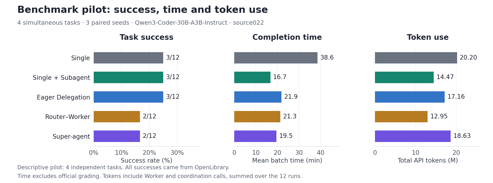
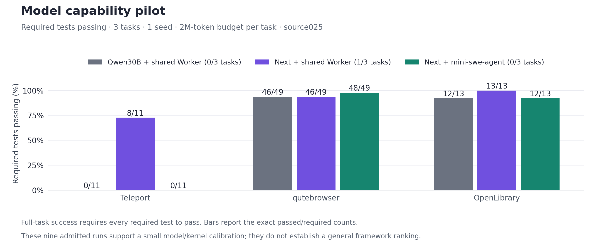
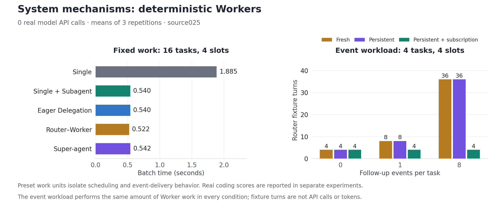

# Results

Published measurements cover a small controlled coding pilot, a three-task model
selection study, and deterministic mechanism tests. Stage 2 formal results are
pending live evaluation. The tracks below retain their original scopes.

## Controlled coding pilot

The primary source022 comparison used Qwen3-Coder-30B-A3B-Instruct across four
independent SWE-bench Pro tasks and three paired seeds. The 60 task grades give
12 task–seed observations per arm. All 13 successes came from OpenLibrary. The
sample supports descriptive comparisons, with wide uncertainty about new tasks.
[Report](../research/M2-REPORT-003.md) · [Accepted task rows](../research/tables/cases.csv) ·
[Budget and figure definitions](results/README.md#benchmark-pilot)

### Paired outcomes, Eager Delegation and Super-agent

| | Eager success | Eager failure |
| --- | ---: | ---: |
| Super-agent success | 2 | 0 |
| Super-agent failure | 1 | 9 |

The only disagreement was OpenLibrary at seed `20261102`. The Eager Worker
submitted a patch that passed all required tests. The paired Super-agent run
failed. The pair keys are task ID and seed, restricted to primary rows.
[OpenLibrary case](case-studies/openlibrary.md) · [Accepted task rows](../research/tables/cases.csv)

## Model and external-agent pilot

Three tasks and one seed, with a 2M-token per-task allowance. The common source025
Worker resolved 1/3 with Qwen3-Coder-Next and 0/3 with Qwen30B. Next with
mini-swe-agent resolved 0/3 and passed more qutebrowser tests. This model selection
pilot records native end-to-end behavior separately from the controlled arms.
[Exact counts and trajectories](../research/studies/m3-a3/README.md)

## Deterministic system measurements

At 16 tasks and four slots, Eager Delegation took 0.540 s and Super-agent took
0.542 s. In the 36-event fixture, subscriptions reduced Router fixture calls
from 36 to 4. Measurements use three repetitions and zero model API calls.
[System report and scope](../research/studies/m3-a3/SYSTEM-REPORT.md) ·
[Event timeline and replay](architecture/README.md#recorded-demo)

## Stage 2 result index

| Track | Next report | Status |
| --- | --- | --- |
| Native AsynCodeBench | Final and dependency outcomes on all 19 tasks under `async_private` | Environment admission pending |
| Controlled Pro V2 | Paired task results on the 120-task independent candidate subset | Preflight and exclusion audit pending |
| External agents | Separate matched end-to-end comparisons | Only mini-swe-agent pilot published |
| Mechanism comparison | Real-model event density, quality, coordination and latency | Deterministic measurements published |

The Evaluation Suite produces per-seed summaries, paired cross-tables, clustered
intervals and Pareto reports from accepted runs. The older chart generator uses
the original published tables. [Stage 2 reports](../suite/README.md) ·
[Regenerate published figures](results/README.md#regenerate)
