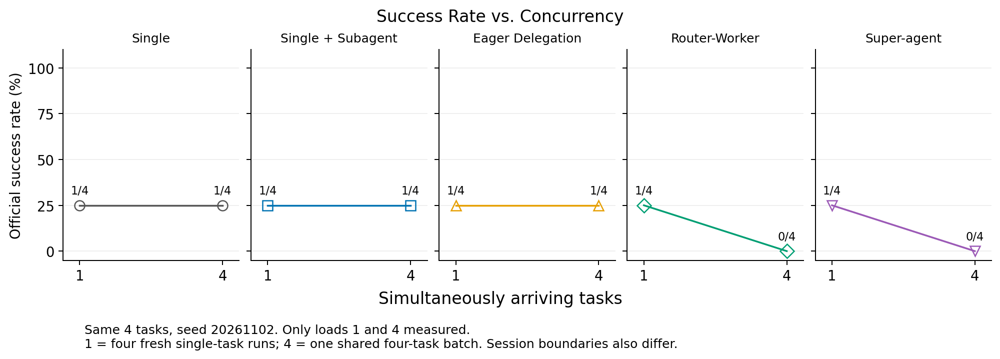
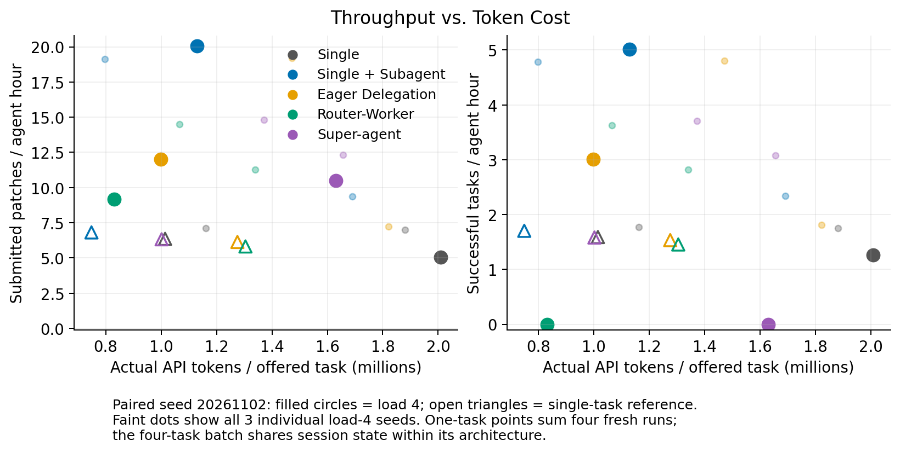
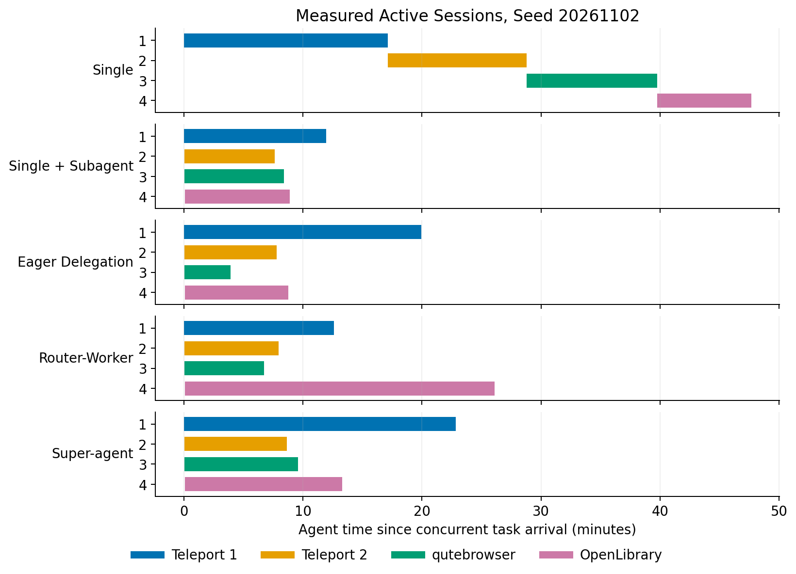

# Stage 1 — M2：有效评分与四任务架构对照

生成时间：2026-11-04T20:19:59.561624+00:00。自最早任务记录 2026-11-02 15:12:09 UTC 起累计约 53.13 小时（估算，包含澄清、环境排查、等待、执行和验证）。

固定四任务、三种子下，Super-agent 成功 2/12，Eager Delegation 成功 3/12；Super-agent/Eager 的整批 Agent 计时总量比为 0.892，实际 API tokens 比为 1.085。这些比值对应本报告的受控任务级实现和固定子集。
三次成对比较中，Super-agent 的整批用时在 1/3 个种子中较低。按官方成功任务计算，Super-agent 吞吐为 2.05 项/Agent 小时，Eager 为 2.74 项/Agent 小时；该指标与补丁提交吞吐分别展示，以保留成功率和种子波动的影响。
60 份主评分共有 13 份成功，覆盖 1/4 道不同题目。按题目的结果见逐例分析；种子重复与已解决题目的覆盖范围分别记录。

本报告完成固定四任务、三个随机种子、五种架构的 60 份主评分，并提供相同四任务、首个种子的 20 份单任务参考。全部比较使用 source-022、相同模型服务语义和本机受限执行环境。原始 Harbor 对每个捕获补丁评分，并与独立执行核对。原生 AsynCodeBench 和公开复现另行验收。

## 1. 研究范围与实际版本

本轮比较五种任务级调度实现。Single 共用主会话依次执行；Single + Subagent 由主会话选择自行执行或委派；Eager Delegation 强制委派；Router–Worker 使用每事件新路由上下文；Super-agent 保留路由历史、工作会话和订阅关系。本次四个 Pro 任务独立同时到达，主要检验调度、并行和协调成本。订阅直通与复杂依赖的收益需要对应事件和依赖任务证据。

| 对象 | 冻结身份 |
| --- | --- |
| 研究代码 | source-022，`dd7b2b411b0084a763180a219e8c373797c3092e779498f008098143e1b5ab16`，40 个作者文件 |
| SWE-bench Pro | `66f92766bba642462d4bbe5479e83f91f9211862` |
| Harbor | `f6cf2e2e86a102a9d2980ce8888f4bda251aa998` |
| AsynCodeBench | `2a639b049f249e79eb2031876bc06a110be9ac3a` |
| Software Agent SDK | `944284310d9a5f1ccad0ef8c2d7c4c38342b9952` |
| 原始 DeepSeek 核心 | `6337fc823ce20251c8de8085948165c81aaa701e`；完整 DSH 宿主执行环境仍为已披露缺口 |
| 模型文件 | 26 文件权重/tokenizer 清单：`953dbd6e73944101fc6b15acde59399743f4e58031fba041072df8f0d7c123cc` |

完整 DSH 宿主调度与任务内部递归分解尚未实现；本报告中的 Super-agent 指明确记录的受控任务级实现。原始核心 113 项测试与研究模块 Windows/Linux 各 45 项检查提供对应模块证据，真实任务成败由下列 Benchmark 结果说明。

## 2. 公平条件与评分验收

| 条件 | 实际设置 |
| --- | --- |
| 任务 | 预先冻结 4 个任务：两个 Teleport、一个 qutebrowser、一个 OpenLibrary；3 个仓库、2 种语言 |
| 种子与到达 | 20261102、20261103、20261104；四任务到达时间均为 0；架构顺序按冻结计划循环轮换 |
| 本机执行 | Windows WHPX 加速的 Linux 6.1.0-54；Docker 26.1.4、cgroup v2；总池 4 vCPU / 16 GiB、无 guest swap |
| Pro 每任务限制 | 实际 CPU 配额 1 核、内存上限 4 GiB，独立 CPU 位置；已核验 cpu.max、memory.max、亲和性、CPU 节流和内存超限退出 |
| 模型 | Qwen3-Coder-30B-A3B-Instruct，BF16、TP4；模型位于百度 GPU 节点；同一 Linux 网关负责调度控制和账本；任务与评分位于用户本机；最大并发序列 4、prefix caching 关闭 |
| 生成 | context 262144；max output 8192；temperature 0.7、top_p 0.8、top_k 20、repetition_penalty 1.05；请求使用对应种子 |
| 停止与预算 | 每任务最多 100 次请求、活跃执行 3000 秒、工具 600 秒；四任务总预算 128M、单任务 32M tokens |
| 预留与上下文 | 同服务 tokenizer 的真实输入长度 + 最大输出长度；共同策略压缩较早的大型工具观察，原始输出保留于轨迹 |
| 活动状态 | Linux 控制网关的本地 /dev/shm；完成批次逐文件 SHA-256 核验后归档到 GPFS；支持控制进程重启恢复，网关重启或断电会丢失尚未归档的状态 |

本机宿主为 AMD Ryzen 9 9955HX，16 核心 / 32 逻辑处理器；QEMU 进程亲和性固定为逻辑处理器 8–11（0xF00），宿主其他进程继续运行。墙钟测量对应这一共享 Windows 宿主条件。模型使用四张 NVIDIA A100-SXM4-80GB，驱动 535.261.03，所在节点 CPU 为 Intel Xeon Platinum 8350C；服务 CPU 亲和性保持一致。原始硬件清单随证据提供。
单任务参考执行期间，本机与网关的专属 SSH 通道发生一次断开。Eager–OpenLibrary 的首条只读命令等待 311.30 秒并返回 Docker 连接错误；本机 VM 与模型服务持续运行。amendment081 在最终结果文件生成前冻结：无论补丁成败均保留并排除该尝试，原队列结束后以完全相同配置固定补跑一次。最终参考使用 19 份未受影响的原运行和 1 份补跑；主对照 60 份保持原样。原尝试全部成本与输出保留。工具层将此次后端错误作为观察返回，运行条件的有效性由该次明确的环境证据另行审查。
理论预留上限为 404 × 262144 = 105,906,176 tokens，低于四任务的 128M；单任务上限 101 × 262144 = 26,476,544，低于 32M。该计算适用于本轮四个初始请求、无后续事件的工作负载；实际拒绝次数另列。排队等待计入整批延迟，单任务活跃时限从取得执行会话后开始。

四任务均通过参考补丁成功、空补丁失败、隐藏测试和历史泄漏检查；原始 Harbor 的 8 份 oracle/nop 对照与独立评分一致。正常捕获补丁核对测试状态和原始输出字节。语法或运行时导入异常须在同一镜像证明原代码有效、捕获补丁复现同一异常，且原始 Harbor 给出 0 分、输出一致；原始无效标记保留。模型补丁造成官方完整时限超时时，保留独立 raw valid=false、success=null，以及 Harbor 缺失的 trial reward 和 VerifierTimeoutError；原始一例 Job Mean 为 0，另附统一失败说明，缺少的测试输出相等性记为 null。其他原因未明的无效结果停止执行。

vLLM 0.20.0 的截断工具回复结束原因由任务专用兼容启动器修正，原始安装文件保持完整。修复前四种输出上限均复现错误结束原因；修复后 48 项契约及真实 HTTP 对照通过。长度优先处理依据见[上游修复](https://github.com/vllm-project/vllm/pull/59324/files)。Harbor 缺失 reward 的聚合规则见[固定版本源码](https://github.com/laude-institute/harbor/blob/f6cf2e2e86a102a9d2980ce8888f4bda251aa998/src/harbor/metrics/base.py)。

## 3. 五组主结果

| 架构 | 成功 | 平均整批 Agent 秒数 | 补丁/Agent 小时 | 成功任务/Agent 小时 | 实际 API tokens | 模型调用 | 协调调用 |
| --- | --- | --- | --- | --- | --- | --- | --- |
| Single | 3/12 | 2315.37 | 6.22 | 1.55 | 20,203,080 | 360 | 0 |
| Single + Subagent | 3/12 | 1003.50 | 14.35 | 3.59 | 14,466,477 | 643 | 12 |
| Eager Delegation | 3/12 | 1311.62 | 10.98 | 2.74 | 17,160,734 | 749 | 12 |
| Router–Worker | 2/12 | 1279.43 | 11.26 | 1.88 | 12,945,570 | 616 | 12 |
| Super-agent | 2/12 | 1170.60 | 12.30 | 2.05 | 18,626,321 | 770 | 12 |

| 架构 | 逐次预留 tokens 之和 | 因预留拒绝的请求 | 最大实际输入 tokens | 最大单次预留 tokens | 模型上下文长度 |
| --- | --- | --- | --- | --- | --- |
| Single | 23,042,320 | 0 | 133664 | 141856 | 262144 |
| Single + Subagent | 19,610,357 | 0 | 62240 | 70432 | 262144 |
| Eager Delegation | 23,155,556 | 0 | 75904 | 84096 | 262144 |
| Router–Worker | 17,875,208 | 0 | 46110 | 54302 | 262144 |
| Super-agent | 24,806,077 | 0 | 55461 | 63653 | 262144 |

预留之和累计每次请求的真实输入加最大输出；请求结算后释放其未用部分，因此该累计值与实际 API 用量分别报告。所有已接受运行的未结算调用与剩余预留均为零。

| 架构 | 平均任务提交延迟（秒） | 中位提交延迟（秒） | 最大提交延迟（秒） |
| --- | --- | --- | --- |
| Single | 1625.50 | 1600.25 | 2858.80 |
| Single + Subagent | 676.20 | 560.08 | 1539.17 |
| Eager Delegation | 740.70 | 581.05 | 1987.32 |
| Router–Worker | 679.83 | 537.85 | 1566.98 |
| Super-agent | 702.10 | 579.65 | 1370.89 |

提交延迟从共同到达时刻到补丁捕获，包含会话排队。上表为十二份任务运行的描述性统计，逐例成功与失败另列。

主对照有 1 份补丁在模型执行以 blocked 状态结束后仍通过官方测试。模型终止状态、模型自述和最终补丁评分分别保留，完整对应关系见逐例结果。
吞吐使用整批 Agent 计时；官方评分、镜像准备和事后诊断耗时单独记录。补丁提交、模型报告完成和官方成功分别统计。12 份评分来自 4 个任务的 3 次种子重复，任务层面的独立样本数为 4；本表提供小规模 Pilot 证据。

| 架构 | seed 20261102 | seed 20261103 | seed 20261104 |
| --- | --- | --- | --- |
| Single | 1/4 | 1/4 | 1/4 |
| Single + Subagent | 1/4 | 1/4 | 1/4 |
| Eager Delegation | 1/4 | 1/4 | 1/4 |
| Router–Worker | 0/4 | 1/4 | 1/4 |
| Super-agent | 0/4 | 1/4 | 1/4 |

## 4. 并发、成本与 Eager 对照

| 种子 | Eager 成功 | Super 成功 | Eager Agent 秒数 | Super Agent 秒数 | Super/Eager 用时 | Super/Eager tokens |
| --- | --- | --- | --- | --- | --- | --- |
| 20261102 | 1/4 | 0/4 | 1197.43 | 1371.13 | 1.145 | 1.633 |
| 20261103 | 1/4 | 1/4 | 749.91 | 1169.37 | 1.559 | 1.125 |
| 20261104 | 1/4 | 1/4 | 1987.54 | 971.30 | 0.489 | 0.753 |

并发 1 与 4 的连线使用同样四任务、同一种子 20261102。并发 4 的另外两个种子以独立点展示；仅测量 1 和 4 两种负载。单任务参考由四次独立运行组成，每次重建会话，吞吐分母为四个 Agent 时钟之和；四任务批次共用同一架构实例及其会话。负载与会话边界共同变化，曲线提供两类运行条件的描述性对照。横轴为实际输入加输出 tokens，包含协调请求。

| 架构 | 首种子 Agent 秒数 | 会话峰值 | 会话重叠秒数 | 协调 tokens | 实际 tokens | 预留总量 | 预算拒绝 |
| --- | --- | --- | --- | --- | --- | --- | --- |
| Single | 2859.01 | 1 | 0.00 | 0 | 8,032,530 | 8,955,750 | 0 |
| Single + Subagent | 718.36 | 4 | 532.03 | 14,322 | 4,516,355 | 6,131,297 | 0 |
| Eager Delegation | 1197.43 | 4 | 523.80 | 14,302 | 3,991,197 | 5,787,412 | 0 |
| Router–Worker | 1567.21 | 4 | 753.79 | 6,195 | 3,322,406 | 4,730,232 | 0 |
| Super-agent | 1371.13 | 4 | 796.39 | 14,310 | 6,519,058 | 8,557,048 | 0 |

时间线使用会话锁实际取得与释放时间。任务进入 running 或工作进程建立之后仍可能排队，单独的状态字段不足以说明执行重叠。完整模型请求重叠、路由选择、最长输入、预留、输出结束原因和逐任务延迟保存在原始分析数据中。

| 架构 | 四任务：路由 self | 四任务：delegate | 单任务参考：路由 self | 单任务参考：delegate |
| --- | --- | --- | --- | --- |
| Single | 0 | 0 | 0 | 0 |
| Single + Subagent | 0 | 12 | 1 | 3 |
| Eager Delegation | 0 | 12 | 0 | 4 |
| Router–Worker | 0 | 12 | 0 | 4 |
| Super-agent | 0 | 12 | 0 | 4 |

本表统计真实 route 工具输出；Single 按定义直接执行，使用零次路由 API。可选委派的选择与强制委派分别记录；单任务与四任务同时改变负载和会话边界，其观察到的选择差异按这两类条件共同解释。

## 5. 逐任务结果与失败

| 任务 | Single | Single + Subagent | Eager Delegation | Router–Worker | Super-agent |
| --- | --- | --- | --- | --- | --- |
| T1 Teleport | 0/3 | 0/3 | 0/3 | 0/3 | 0/3 |
| T2 Teleport | 0/3 | 0/3 | 0/3 | 0/3 | 0/3 |
| T3 qutebrowser | 0/3 | 0/3 | 0/3 | 0/3 | 0/3 |
| T4 OpenLibrary | 3/3 | 3/3 | 3/3 | 2/3 | 2/3 |

完整任务 ID、顺序和预先冻结的选择身份见 [任务清单](reproduction/m2-matrix.json)。选择摘要为 `be8c813fe2a13021a21b46a53a81ce7a05c317f460122bf3c97e0e06242b9895`。四任务沿用原始 24 任务 SHA-256 排序清单的前四项，在本轮模型结果产生前冻结；第一项此前已有 M1 失败记录。本轮执行保留原选择，任务替换次数为零。

| 已观察评分类别 | 例数 |
| --- | --- |
| code_compilation_failure; required tests did not execute | 25 |
| model_introduced_python_import_error | 1 |
| official_test_failure | 20 |
| official_verifier_timeout | 1 |
| passed | 13 |

两个 Teleport 任务合计 30 份主运行中，25 份在编译阶段失败。逐例原始诊断包含 Go 语法破坏、未定义标识符和未使用导入，例如 Single 首种子 T2 的未使用导入、Router 首种子 T2 的 `readClusterFlag` / `siteEnvVar` 未定义，以及 Eager 首种子 T2 的 const 声明语法错误。这些证据直接显示最终补丁有效性仍是当前共同 Worker 与模型组合的主要限制；更多样本之前应先检查这些已保留的编辑与测试轨迹。

| 模型执行状态 | 官方成功 | 官方失败 |
| --- | --- | --- |
| blocked | 1 | 8 |
| completed | 12 | 39 |

完整逐例表保留模型声明、实际终止理由、编译诊断、缺少的必需测试、原始失败测试和补丁摘要。首种子 Router–Worker 的 OpenLibrary 补丁在星号扫描循环中遗漏索引递增：同镜像原函数正常返回，应用同一补丁后触发 5 秒诊断超时；两份正式执行仍使用原始 3000 秒时限并达到超时。诊断的 5 秒上限仅用于定位原因。

## 6. 原生 AsynCodeBench

| 指标 | 结果 |
| --- | --- |
| 原生协议与任务 | async_private / asyncodebench:cachetools |
| 官方 bundle 与执行 profile | valid；原始任务分解、权限和标准 100-response profile 保持一致 |
| Final Success Rate | 0/1 |
| Dependency Pass Rate | 0/5 |
| Dependency Resolution Step | {"max": null, "min": null, "observed_count": 0, "unresolved_count": 5} |
| 实际 tokens | 3,030,909 |
| Adapter 实际模型调用 | 115 |
| SDK 原始 model_calls 字段 | 0 |
| 协议用时（秒） | 931.17 |
| 最终测试 | {"collected": 215, "errors": 0, "evaluation_failure_kind": null, "exit_code": 1, "failed": 62, "outcome": "failed", "passed": 153, "success": false, "synthetic_summary": false, "timed_out": false} |

| 原生实际 SDK 容器资源 | 观测值 |
| --- | --- |
| cpu.max | "max 100000" |
| memory.max | "max" |
| cpuset.cpus.effective | "0-3" |
| affinity | [0, 1, 2, 3] |

原生协议的模型调用数由共享 Worker 的用量账本独立核对；SDK 字段保留原值。DRS 未观测到的依赖保持 null。原生 SDK 在本机 4 vCPU / 16 GiB 总池执行，单容器实际值如上；max 表示该项采用 SDK 默认值、由 VM 总池提供上限。Pro 的每任务限制与原生 profile 分别报告。此处提供一个原生依赖任务的端到端证据，五种研究架构与 Benchmark 执行协议分别标识。
初始公开测试快照与最终测试输出分别保留；最终通过数量包含原始基线已经通过的测试。依赖进展依据原生 ADPR、DRS 与逐项依赖记录报告。

| 测试状态来源 | 收集 | 通过 | 失败 | 错误 |
| --- | --- | --- | --- | --- |
| Benchmark 公开初始快照 | 215 | 153 | 62 | 0 |
| 本轮原始协议最终测试 | 215 | 153 | 62 | 0 |

公开初始快照来自固定 Benchmark 记录，其依赖与 Python 版本保留原值；本轮实际运行环境由准备镜像和执行回执标识。相同的通过数量与最终依赖评分分别展示。
原始权限检查记录 Scope Violation Rate=2/2。下表保留每个角色的允许文件与越界文件；本协议按原规则拒绝越界产物，模型报告完成与可整合产物分别判定。

| 角色 | 允许修改 | 越界文件 | 权限检查 |
| --- | --- | --- | --- |
| key_agent | src/cachetools/keys.py | src/cachetools/func.py、src/cachetools/func.py.backup、src/cachetools/keys.py.backup | False |
| decorator_agent | src/cachetools/func.py | src/cachetools/func.py.backup、src/cachetools/func.py.bak | False |

原生运行镜像基于固定的 wentingzhao/cachetools 原始任务镜像与 SDK 的 source-minimal 构建目标，SDK Dockerfile 保持原样；另行准备锁定的离线 Python 依赖及仅含初始提交的任务仓库缓存。镜像、依赖和缓存摘要及构建配方随证据提供。本轮完成的是已准备运行时的任务验收，完整新宿主机重建仍需另行验证。研究 Adapter 从宿主 source-022 加载，选择路径和文件摘要单独记录。

## 7. 复现、费用与版本处置

| 验收 | 结果 |
| --- | --- |
| 干净 Python 环境 | 原始 Harbor uv.lock、Python 3.12.15、source-022 wheel；22 个已安装 Python 模块字节与冻结清单一致；35 项配置准备通过；另有全新 venv 离线直接安装源码，22 个 Python 文件和1个工具桥接文件字节一致，CLI通过 |
| 迁移材料重放 | 当前成功补丁 1 分、历史语法错误补丁 0 分；禁止访问原容器；原始测试输出逐字一致 |
| 评分分支与版本 | 正常成功、语法错误、运行时导入错误、完整3000秒时限四类验收；前074的25份补丁由最终评分封装重新核对，原始证据保留 |
| 真实模型公开任务 | instance_internetarchive__openlibrary-09865f5fb549694d969f0a8e49b9d204ef1853ca-ve8c8d62a2b60610a3c4631f5f23ed866bada9818；成功=True；27 次调用；338,106 tokens |
| 费用 | M2 全部已记账实际 tokens=136,016,288；请求=5,445；未知用量=0 |
| 硬件货币价格 | 未知；自托管 API 传输费用约定与 GPU 驻留时间分别记录 |
| GitHub | 截至本报告冻结时间：本地材料齐备，尚未提交、推送或发布；后续动作与提交身份保存于独立发布回执 |

最终材料包括 [安装与统一命令](reproduction/INSTALL.txt)、五组运行脚本、单个公开任务命令、[捕获成功补丁的官方重放材料](public-example/README.md)、完整配置/模型/镜像摘要、原始轨迹与成本、独立图表和源代码安装包。[原生运行条件](reproduction/NATIVE-LOCAL.md)另行说明准备镜像与新宿主重建的验证边界。公开模型重新生成存在服务数值计算与采样变动；捕获补丁重放和模型重新生成分别验收。

| 模型服务实例 | 已记账请求 | 实际 API tokens | 观测 GPU·小时 |
| --- | --- | --- | --- |
| 001 | 290 | 8,965,386 | 10.041 |
| 002 | 25 | 564,833 | 0.380 |
| 003 | 344 | 8,633,069 | 2.420 |
| 004 | 161 | 3,887,061 | 3.259 |
| 005 | 254 | 5,575,468 | 2.368 |
| 006 | 446 | 8,672,668 | 7.738 |
| 007 | 1058 | 31,190,953 | 11.784 |
| 008 | 2700 | 64,913,840 | 30.957 |
| 009 | 167 | 3,613,010 | 4.388 |

M2 观测服务驻留合计 73.335 GPU·小时，包含加载、模型生成、工具执行、评分及空闲等待，并非 GPU 核函数执行时间或平台计费时长。九个服务实例互斥相加；主对照、参照、原生、公开任务与诊断分项均已包含其中。此前 M1 的 164 次调用、2,434,227 tokens 另行保留，未计入本表的 M2 总额。全部服务均已恢复原有 GPU 保留进程，并核验显存与持续利用率；平台作业保持原状态。

source-021、共享存储下失败的 source-022 尝试及 M2 早期单任务尝试的原始证据保留并计入相应成本，比较表使用本次统一 source-022、本地 WAL 存储的冻结队列。评分封装补齐超时与运行时导入错误后的恢复均复用已生成补丁；Router–Worker 与第二种子 Single + Subagent 的模型结果没有重新采样。活动 WAL 使用本地文件系统的依据见 [SQLite 官方说明](https://sqlite.org/wal.html)。

## 8. 解释范围与后续决定

本轮结果的支持范围是固定四任务 Pilot、三个种子、共同模型和资源条件下的任务级调度比较。四任务并行能够激活执行重叠；订阅收益与复杂依赖协作需要相应负载和协议内的架构替换。原生单任务提供运行与评分证据，后续协议内架构对照仍待完成。完整 DSH 宿主、任务内递归委派及更多负载属于明确保留的范围。是否扩展到 24 任务及 1/4/8/16 负载，应依据本轮逐例失败和 Eager/Super-agent 的实际差距另行决定。

验收完成时间：2026-11-04T20:19:59.561624+00:00。累计经过约 53.13 小时（估算）。原始数据和可复现证据随不可变交付清单提供。
