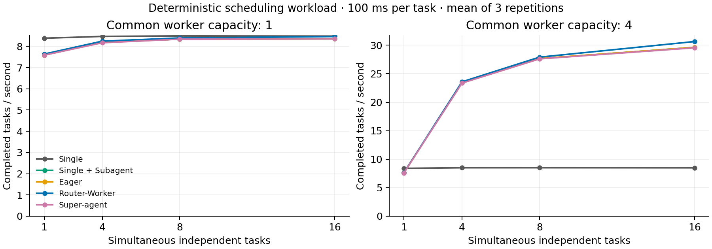
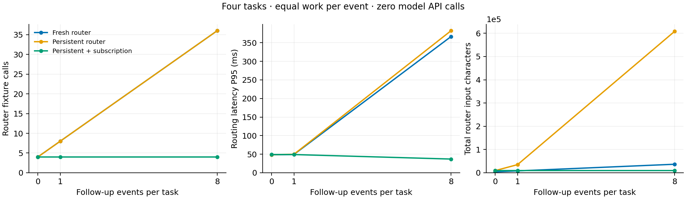

# M3-A3：确定性系统机制测量

本实验使用冻结 source025 的 Runtime、Kernel 和 Journal，实际调用真实调度与持久化代码。Worker 与 Router 使用固定回复，每个不同事件执行一次100ms异步等待；Worker回复等待5ms、Router回复等待10ms。API调用与API tokens均为0。

## 并发容量

共120格：五种架构 × 槽位1/4 × 任务数1/4/8/16 × 三次重复。下表为16任务、4槽位的三次均值。每格完成相同工作量且没有未读事件。

|架构|批次耗时|任务/秒|最大同时工作单元|
|---|---:|---:|---:|
|Single|1.885s|8.49|1|
|Single + Subagent|0.540s|29.62|4|
|Eager Delegation|0.540s|29.62|4|
|Router–Worker|0.522s|30.63|4|
|Super-agent|0.542s|29.54|4|



在这个预设工作负载中，Super-agent、Eager Delegation 与选择委派的 Single + Subagent 具有接近的批次耗时。槽位是逻辑并发容量，异步等待负载提供调度与并行执行证据；真实代码任务的成功率、编译吞吐与模型成本需要 Capability Track 测量。

## 后续事件与订阅

共27格：三种Router配置 × 每任务后续事件0/1/8 × 三次重复，每格4个初始任务。每个事件有独立标记，对应独立100ms工作单元，接收事件数与完成工作数一致。下表为每任务8个后续事件，共36个事件/工作单元的三次均值。

|配置|Router固定回复次数|路由延迟P95均值(ms)|Router输入字符总数均值|工作单元|
|---|---:|---:|---:|---:|
|Fresh Router|36|366.6|36708|36|
|Persistent Router|36|382.3|608368|36|
|Persistent + Subscription|4|37.0|9252|36|



图中 Router 返回固定决策，10ms回复延迟是实验输入。Subscription 减少了需要重新路由的事件；上下文字符数描述该负载中的历史增长，实际模型推理token数与费用尚需真实模型测量。

## 跨进程恢复

在两个任务的空闲检查点保存状态，退出进程，然后在新进程中重放初始事件并追加两个事件。共接收四个唯一事件、完成四个工作单元、重复工作0、未读输入0。另一个含不确定工具操作的检查点按预期拒绝自动重放，要求人工核对外部结果。此次验收覆盖空闲检查点的安全恢复；任意时刻崩溃的外部副作用尚需单独处理。

## 环境、证据与复现

执行主机是百度Gateway，Python3.12.8，64个可见CPU，无CPU亲和性限制，状态存于本机tmpfs。未使用GPU或商业API。每格SQLite、轨迹、记账及汇总保存在system303归档，环境见SYSTEM_ENVIRONMENT.json。

```bash
python research/reproduction/system_track.py results/system-001
```

源码的旧扁平轨迹导出会被事件载荷的kind覆盖记录类型。本实验以SQLite的记录列进行统计；export_trace.py提供保留独立载荷字段的派生导出，原冻结源码和原证据维持原字节。

图表可从归档的 RESULTS.json 重新生成：

```bash
python research/analysis/plot_system.py --input extracted-system303/RESULTS.json --output figures-new
```

绘图环境为Matplotlib3.9.2；全部纵轴从零开始。P95曲线为每次重复P95的均值，原逐次结果保留在CSV和归档中。
